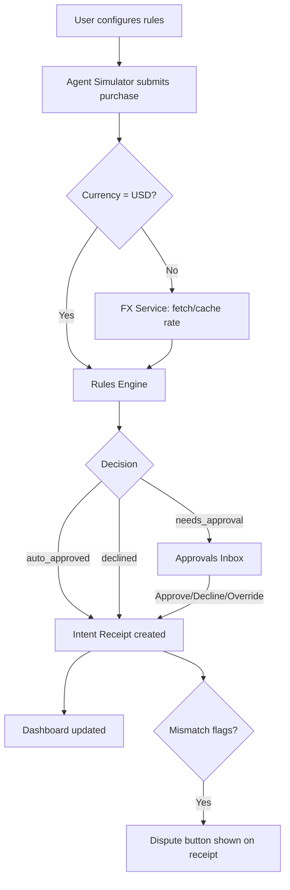

# Design Document

## Overview

Agent Spend Guard is a client-side Next.js web application that gives users control over purchases made on their behalf by AI agents. Users configure spending rules (category limits, merchant limits, approval threshold, blocked categories), a mock agent simulator submits purchase requests, a rules engine evaluates each request and returns a decision, and intent receipts carry the evidence needed to dispute wrong transactions.

All state lives in `localStorage` — no server, no database, no authentication. The Frankfurter public API provides live FX rates for cross-currency purchases, with a 24-hour local cache fallback.

### High-Level User Flow



---

## Architecture

The application is a **Next.js 15 App Router** project deployed to Vercel. Because all state is localStorage, there are no server actions or API routes except the proxy-less external call to `api.frankfurter.dev`. Every page is a Client Component (`"use client"`).

### Architectural Layers

```
┌──────────────────────────────────────────────────┐
│                    UI Layer                       │
│  Pages / Views (Dashboard, Inbox, Rules, etc.)   │
│  React components, Tailwind CSS                  │
└────────────────────┬─────────────────────────────┘
                     │ reads / dispatches
┌────────────────────▼─────────────────────────────┐
│               State Layer (Zustand)               │
│  useSpendGuardStore — single global store         │
│  Subscribers call persistence layer on mutation   │
└───────┬──────────────────────┬────────────────────┘
        │                      │
┌───────▼────────┐   ┌─────────▼──────────────────┐
│  Domain Layer  │   │     Persistence Layer        │
│  rules-engine  │   │  localStorage read/write     │
│  mismatch-     │   │  corruption isolation        │
│    checker     │   │  quota-exceeded handling     │
│  fx-service    │   └────────────────────────────-─┘
│  monthly-reset │
│  dispute-gen   │
└────────────────┘
```

**Key architectural decisions:**

- **Zustand** is chosen over React Context or Redux because it has a minimal API, supports `persist` middleware that wraps localStorage automatically, and avoids prop-drilling across deeply nested client components. The `zustand/middleware` `persist` adapter handles JSON serialization; a thin custom adapter adds the write-before-confirm guarantee and corruption isolation required by Requirement 10.
- **Pure domain functions** (`rulesEngine`, `misMatchChecker`) are isolated in `/src/lib/` with no React or Zustand imports. This keeps them independently testable with Vitest.
- **No server components** are needed. The entire app is static at build time and hydrates on the client. Next.js is used primarily for its routing, Turbopack dev server, and Vercel deployment integration.

---

## Components and Interfaces

### Page / Route Map

| Route | File | Description |
|---|---|---|
| `/` | `app/page.tsx` | Redirects to `/dashboard` |
| `/dashboard` | `app/dashboard/page.tsx` | Spend-vs-limit overview + recent activity |
| `/inbox` | `app/inbox/page.tsx` | Approvals Inbox |
| `/rules` | `app/rules/page.tsx` | Rules configuration |
| `/simulator` | `app/simulator/page.tsx` | Mock Agent Simulator |
| `/receipts` | `app/receipts/page.tsx` | Intent Receipts list |
| `/receipts/[id]` | `app/receipts/[id]/page.tsx` | Single receipt detail + Dispute |

### Component Tree (shared layout)

```
app/layout.tsx (RootLayout)
└── <NavBar />                    # navigation + pending badge
    ├── <PendingBadge />          # live count from store
└── {children}
```

### Key UI Components

| Component | Path | Responsibility |
|---|---|---|
| `NavBar` | `components/NavBar.tsx` | Top navigation; shows pending badge |
| `SpendProgressBar` | `components/SpendProgressBar.tsx` | Category/merchant spend indicator with warning/exceeded states |
| `ActivityFeedItem` | `components/ActivityFeedItem.tsx` | Single row in recent activity feed |
| `PurchaseCard` | `components/PurchaseCard.tsx` | Pending purchase card in Approvals Inbox |
| `OverageWarningModal` | `components/OverageWarningModal.tsx` | Shown before approve when limit would be exceeded |
| `RuleForm` | `components/RuleForm.tsx` | Shared form for create/edit rules |
| `SimulatorForm` | `components/SimulatorForm.tsx` | Agent Simulator form with preset selector |
| `IntentReceiptDetail` | `components/IntentReceiptDetail.tsx` | Full receipt view with mismatch flags |
| `DisputeSummaryPanel` | `components/DisputeSummaryPanel.tsx` | Plain-text dispute output + copy button |
| `StorageWarningBanner` | `components/StorageWarningBanner.tsx` | Non-blocking banner for localStorage errors |

---

## Data Models

All types are defined in `src/types/index.ts`.

### Rules

```typescript
/** A monthly spending cap for a named category (e.g. "Dining"). */
export interface CategoryLimit {
  id: string;            // uuid v4
  type: 'category_limit';
  category: string;      // 1–100 chars
  limitAmountUSD: number; // 0.01 – 999_999_999.99
  createdAt: string;     // ISO 8601 UTC
  updatedAt: string;
}

/** A monthly spending cap for a specific merchant (e.g. "Amazon"). */
export interface MerchantLimit {
  id: string;
  type: 'merchant_limit';
  merchant: string;      // 1–100 chars
  limitAmountUSD: number;
  createdAt: string;
  updatedAt: string;
}

/** Every purchase above this amount is escalated to the Approvals Inbox. */
export interface ApprovalThreshold {
  id: string;
  type: 'approval_threshold';
  thresholdAmountUSD: number; // 0.01 – 999_999_999.99
  updatedAt: string;
}

/** All purchases in this category are auto-declined. */
export interface BlockedCategory {
  id: string;
  type: 'blocked_category';
  category: string;      // 1–100 chars
  createdAt: string;
}

export type SpendingRule =
  | CategoryLimit
  | MerchantLimit
  | ApprovalThreshold
  | BlockedCategory;

export interface RuleSet {
  categoryLimits: CategoryLimit[];
  merchantLimits: MerchantLimit[];
  approvalThreshold: ApprovalThreshold | null;
  blockedCategories: BlockedCategory[];
}
```

### Purchase Request & Structured Intent

```typescript
/** Machine-readable intent fields submitted with a purchase. All optional. */
export interface StructuredIntent {
  maxBudgetAmount?: number;        // numeric spend cap provided by user
  budgetCurrency?: string;         // ISO 4217 (e.g. "EUR")
  travelDates?: string[];          // array of ISO 8601 date strings
  intendedCategory?: string;
}

/** Submitted by the Agent Simulator. */
export interface PurchaseRequest {
  id: string;               // uuid v4
  agentName: string;
  merchantName: string;
  category: string;
  amount: number;           // as submitted (may be non-USD)
  currency: string;         // ISO 4217
  intentText: string | null;
  structuredIntent: StructuredIntent | null;
  travelDates?: string[];      // actual booking dates (e.g. ["2024-11-12", "2024-11-15"])
  submittedAt: string;      // ISO 8601 UTC
}
```

### FX Rate Cache

```typescript
export interface FxRateCacheEntry {
  fromCurrency: string;    // source currency code
  toCurrency: 'USD';
  rate: number;            // rounded to 6 decimal places for storage
  fetchedAt: string;       // ISO 8601 UTC
  isStale: boolean;        // true if loaded from cache during a failed refresh
}

/** Keyed by fromCurrency, e.g. "EUR" → FxRateCacheEntry */
export type FxRateCache = Record<string, FxRateCacheEntry>;
```

### Rules Engine Decision

```typescript
export type DecisionOutcome = 'auto_approved' | 'needs_approval' | 'declined';

export interface RuleFailure {
  ruleType: 'invalid_amount' | 'blocked_category' | 'approval_threshold'
           | 'no_intent' | 'category_limit' | 'merchant_limit' | 'fx_failed';
  explanation: string;    // human-readable clause, e.g. "over your $50.00 threshold"
}

export interface EngineDecision {
  outcome: DecisionOutcome;
  failures: RuleFailure[];
  explanation: string;    // concatenation of all failure.explanation strings
  evaluatedAt: string;    // ISO 8601 UTC
}
```

### Intent Receipt & Mismatch

```typescript
export type MismatchFlagType = 'price_mismatch' | 'date_mismatch' | 'category_mismatch';

export interface MismatchFlag {
  type: MismatchFlagType;
  detail: string;         // human-readable description of the mismatch
}

export type PurchaseStatus =
  | 'auto_approved'
  | 'needs_approval'
  | 'approved'        // user manually approved
  | 'declined'        // auto-declined or manually declined
  | 'expired';        // monthly reset expiry

export interface OverrideLog {
  overriddenAt: string;   // ISO 8601 UTC
  overageDetail: string;  // e.g. "Dining $60.00 over $300.00 monthly limit"
}

export interface IntentReceipt {
  id: string;             // same as PurchaseRequest.id
  purchaseRequest: PurchaseRequest;

  // Currency conversion (populated for non-USD purchases)
  usdEquivalentAmount: number | null;
  fxRate: FxRateCacheEntry | null;

  // Engine output
  decision: EngineDecision;
  status: PurchaseStatus;

  // Mismatch analysis
  mismatches: MismatchFlag[];
  priceCheckSkipped: boolean;
  priceCheckSkipReason?: string;

  // Manual actions
  approvedAt: string | null;      // ISO 8601 UTC
  declinedAt: string | null;
  overrideLog: OverrideLog | null;

  createdAt: string;              // ISO 8601 UTC
  updatedAt: string;
}
```

### Monthly Reset State

```typescript
export interface MonthlyResetState {
  lastSeenMonth: string | null; // "YYYY-MM" in user local timezone, or null on first run
}
```

### localStorage Keys

All keys share the `asg_` prefix to avoid collisions.

| Key | Type | Contents |
|---|---|---|
| `asg_rules` | `RuleSet` | All spending rules |
| `asg_receipts` | `IntentReceipt[]` | All intent receipts (includes pending) |
| `asg_fx_cache` | `FxRateCache` | FX rates keyed by source currency |
| `asg_monthly` | `MonthlyResetState` | Last-seen month for reset detection |

Pending purchases are not stored separately — they are derived by filtering `asg_receipts` where `status === 'needs_approval'`.

---

## Rules Engine

### Pure Function Signature

```typescript
// src/lib/rules-engine.ts

export interface EngineInput {
  request: PurchaseRequest;
  usdAmount: number;           // pre-converted USD equivalent (NaN if FX failed)
  fxFailed: boolean;           // true when conversion was not possible
  rules: RuleSet;
  committedSpend: CommittedSpend; // current month's spend totals
}

export interface CommittedSpend {
  byCategory: Record<string, number>;  // category → USD sum (approved + pending)
  byMerchant: Record<string, number>;  // merchant → USD sum (approved + pending)
}

export function evaluateRules(input: EngineInput): EngineDecision
```

`evaluateRules` is a pure function. It reads no globals, calls no APIs, and produces no side effects. The same inputs always produce the same output.

### Evaluation Order and Short-Circuit Logic

```
Step 1: Invalid amount check         → SHORT-CIRCUIT on fail → outcome: declined
Step 2: FX failed check              → SHORT-CIRCUIT on fail → outcome: needs_approval
Step 3: Blocked category check       → SHORT-CIRCUIT on fail → outcome: declined
Step 4: Approval threshold check     → add to failure list, continue
Step 5: No-intent check              → add to failure list, continue
Step 6: Category limit check         → add to failure list, continue
Step 7: Merchant limit check         → add to failure list, continue

After steps 4–7:
  If failure list is non-empty → outcome: needs_approval
  If failure list is empty     → outcome: auto_approved
```

**Rationale for collect-all-failures model (steps 4–7):** The user needs to see every reason a purchase was escalated in a single decision explanation, not just the first one encountered. Steps 1–3 short-circuit because they represent conclusive outcomes that supersede all downstream rules.

### Headroom Calculation

```typescript
// "within limit" means committed + proposed ≤ limit (exact equality is allowed)
function wouldExceedLimit(
  committed: number,
  proposedUSD: number,
  limitUSD: number
): boolean {
  return committed + proposedUSD > limitUSD;
}
```

### Explanation String

Each `RuleFailure.explanation` is a concise clause. The final `EngineDecision.explanation` is their join:

```
"over your $50.00 threshold and puts Travel $120.00 over the $300.00 monthly limit"
```

Currency amounts are formatted with `Intl.NumberFormat('en-US', { style: 'currency', currency: 'USD', minimumFractionDigits: 2 })`.

---

## Mismatch Checker

### Pure Function Signature

```typescript
// src/lib/mismatch-checker.ts

export function checkMismatches(
  structuredIntent: StructuredIntent | null,
  intentText: string | null,
  purchase: PurchaseRequest,
  usdEquivalentAmount: number | null,
  fxCache: FxRateCache
): { flags: MismatchFlag[]; priceCheckSkipped: boolean; priceCheckSkipReason?: string }
```

Returns an empty array when both `intentText` and all `StructuredIntent` fields are absent (the `no_intent` case).

### Price Mismatch Check

Both amounts are converted to USD before comparison, using cached FX rates.

1. Required fields: `structuredIntent.maxBudgetAmount` and `structuredIntent.budgetCurrency` must both be present.
2. Convert `maxBudgetAmount` to USD: if `budgetCurrency === "USD"` use as-is; otherwise look up `fxCache[budgetCurrency]`. If no rate is cached, skip the price check and record `priceCheckSkipped: true` with note "price check skipped — no rate for {budgetCurrency}" on the Intent_Receipt.
3. The purchase's USD equivalent is already available as `usdEquivalentAmount` on the receipt (from the FX conversion step). If `usdEquivalentAmount` is null (conversion failed), skip the price check with the same note.
4. Flag if `usdEquivalentAmount > maxBudgetAmountUSD * 1.05` (more than 5% over budget in USD terms).
5. At exactly the 5% boundary, no flag is raised.

### Date Mismatch Check

- Required: `structuredIntent.travelDates` is present and non-empty.
- Compare each date in `structuredIntent.travelDates` against `purchase.travelDates`. Flag if any date in `structuredIntent.travelDates` does not appear in `purchase.travelDates` (exact ISO 8601 string comparison).
- If `structuredIntent.travelDates` is absent or empty, or `purchase.travelDates` is absent, no flag is raised.

### Category Mismatch Check

- Required: `structuredIntent.intendedCategory` is present.
- Flag if `purchase.category` (case-insensitive trim comparison) does not match `intendedCategory`.

---

## FX Conversion Service

### Interface

```typescript
// src/lib/fx-service.ts

export interface FxResult {
  usdAmount: number;
  rate: number;         // rate used for conversion
  isStale: boolean;     // true if a cached (possibly stale) rate was used
  failed: boolean;      // true if no rate was available at all
}

export async function convertToUSD(
  amount: number,
  fromCurrency: string,
  cache: FxRateCache,
  timeoutMs?: number    // default 5000
): Promise<{ result: FxResult; updatedCache: FxRateCache }>
```

The function returns the updated cache as part of its result so that the caller (Zustand store action) can write the updated cache to localStorage before completing the purchase flow — maintaining the write-before-confirm guarantee.

### Cache Lookup Logic

```
1. If fromCurrency === "USD": return { usdAmount: amount, rate: 1, isStale: false, failed: false }
2. Look up cache[fromCurrency]
3. If cache entry exists AND (now - fetchedAt) < 24 hours:
     use cached rate (isStale = false)
4. Else:
     attempt fetch from https://api.frankfurter.dev/v1/latest?base={fromCurrency}&symbols=USD
     with 5-second AbortController timeout
     if fetch succeeds and response.rates[toCurrency] exists:
       newRate = response.rates[toCurrency]
       update cache entry with newRate and fetchedAt = now
       return result (isStale = false)
     else (failure, timeout, or unexpected response shape):
       if stale cache entry exists:
         return stale cached rate (isStale = true)
       else:
         return { failed: true }
```

### Frankfurter API Endpoint

```
GET https://api.frankfurter.dev/v1/latest?base={fromCurrency}&symbols={toCurrency}
Response: { "amount": 1.0, "base": "EUR", "date": "2026-10-29", "rates": { "USD": 1.113 } }
```

The rate is at `response.rates[toCurrency]`. No API key is required.

The rate fetch is encapsulated in a single function `fetchFxRate(from, to)` so the URL and response parsing are in one place and easy to update if the API changes.

### Error Handling

| Condition | Outcome |
|---|---|
| `fromCurrency === "USD"` | No API call; rate = 1 |
| Cache hit (< 24h) | No API call; use cached rate |
| API success | Update cache, use new rate |
| API timeout / network error + stale cache | Use stale rate, `isStale = true` |
| API returns 404 / 422 or unexpected response shape (unknown currency) | Treat as failure |
| API failure + no cache | `failed = true` → engine returns `needs_approval` |

---

## Persistence Layer

### Write-Before-Confirm Pattern

Every store mutation follows this sequence:

```
1. Compute next state in memory
2. Write next state to localStorage (via persistenceLayer.write)
3. If write succeeds: commit to Zustand store (triggers re-render)
4. If write fails (quota exceeded):
     a. Set store.storageWarning = true (triggers StorageWarningBanner)
     b. Continue with in-memory update (session-only)
```

This ensures the UI never shows a confirmed state that has not been persisted.

### Corruption Isolation

```typescript
// src/lib/persistence.ts

export function safeRead<T>(key: string, fallback: T): T {
  try {
    const raw = localStorage.getItem(key);
    if (raw === null) return fallback;
    return JSON.parse(raw) as T;
  } catch {
    console.warn(`[asg] corrupt entry for key "${key}", resetting to fallback`);
    return fallback;
  }
}

export function safeWrite<T>(key: string, value: T): boolean {
  try {
    localStorage.setItem(key, JSON.stringify(value));
    return true;
  } catch (e) {
    // QuotaExceededError or SecurityError
    return false;
  }
}
```

Individual key failures are isolated — a corrupt `asg_fx_cache` does not prevent `asg_rules` from loading.

### localStorage Availability Guard

```typescript
export function isLocalStorageAvailable(): boolean {
  try {
    const probe = '__asg_probe__';
    localStorage.setItem(probe, '1');
    localStorage.removeItem(probe);
    return true;
  } catch {
    return false;
  }
}
```

If localStorage is unavailable (e.g., private browsing with strict settings), the app initialises with empty in-memory defaults and shows the `StorageWarningBanner`.

---

## State Management

### Zustand Store Shape

```typescript
// src/store/useSpendGuardStore.ts

interface SpendGuardState {
  // Persisted data
  rules: RuleSet;
  receipts: IntentReceipt[];
  fxCache: FxRateCache;
  lastSeenMonth: string | null;

  // Transient UI state
  storageWarning: boolean;
  storageWarningMessage: string | null;

  // Derived (computed on access)
  pendingCount: () => number;
  committedSpend: () => CommittedSpend;
  committedSpendExcluding: (excludeReceiptId: string) => CommittedSpend;

  // Actions
  addRule: (rule: SpendingRule) => void;
  updateRule: (rule: SpendingRule) => void;
  deleteRule: (id: string) => void;

  submitPurchase: (request: PurchaseRequest) => Promise<void>;
  approvePurchase: (receiptId: string) => void;
  declinePurchase: (receiptId: string) => void;
  overridePurchase: (receiptId: string, overageDetail: string) => void;

  runMonthlyResetIfNeeded: () => void;
  dismissStorageWarning: () => void;
}
```

### Committed Spend Calculation

`committedSpend()` is a derived getter that filters receipts for the current calendar month and sums:
- All receipts with `status === 'auto_approved'`
- All receipts with `status === 'approved'`
- All receipts with `status === 'needs_approval'` (pending — counted for worst-case headroom)

Receipts with `status === 'declined'` or `status === 'expired'` are excluded.

### submitPurchase Flow

```
1. Validate amount > 0 (UI-side, before calling store)
2. If currency ≠ USD: call convertToUSD → get FxResult + updatedCache
3. Write updatedCache to localStorage (asg_fx_cache)
4. Call evaluateRules(request, usdAmount, rules, committedSpend())
5. Run checkMismatches(structuredIntent, intentText, request, usdAmount, fxCache)
6. Construct IntentReceipt
7. Append receipt to receipts array
8. Write receipts to localStorage (asg_receipts)
9. Update Zustand store
```

### Approval Re-evaluation and Double-Count Prevention

When re-evaluating committed spend at approval time, the receipt being approved MUST be excluded from the `committedSpend()` calculation. This prevents double-counting because the pending item is already included in committed spend. Pass the `receiptId` to a filtered `committedSpendExcluding(receiptId)` getter that excludes that specific receipt before summing.

---

## Monthly Reset Logic

### Detection on Initialisation

```typescript
function getCurrentMonth(): string {
  // Returns "YYYY-MM" using the user's local timezone
  const now = new Date();
  const year = now.getFullYear();
  const month = String(now.getMonth() + 1).padStart(2, '0');
  return `${year}-${month}`;
}
```

On `useEffect` at app startup, `runMonthlyResetIfNeeded()` is called:

```
currentMonth = getCurrentMonth()
if lastSeenMonth === null:
  set lastSeenMonth = currentMonth, no reset
else if lastSeenMonth !== currentMonth:
  Mark all receipts where:
    status === 'needs_approval'
    AND receipt month (local timezone) < currentMonth
  → status = 'expired'
  Set lastSeenMonth = currentMonth
  Write both asg_receipts and asg_monthly to localStorage
```

Committed spend totals reset automatically because the `committedSpend()` getter only counts receipts whose `submittedAt` falls in the current calendar month.

---

## Agent Simulator Presets

Four presets are defined in `src/lib/simulator-presets.ts`:

| Preset | Category | Amount | Currency | Cross-currency? | travelDates (purchase) | Intent travelDates | Demo mismatch |
|---|---|---|---|---|---|---|---|
| Coffee Shop | Dining | 8.50 | USD | No | — | — | None |
| Hotel Lisbon | Travel | 480.00 | EUR | Yes | ["2024-11-12", "2024-11-15"] | ["2024-11-12", "2024-11-14"] | Date mismatch (checkout off by one day) |
| Grocery Run | Groceries | 95.00 | USD | No | — | — | None |
| Flight Tokyo | Travel | 85,000 | JPY | Yes | ["2024-12-01", "2024-12-08"] | ["2024-12-01", "2024-12-08"] | None |

Hotel Lisbon intentionally uses checkout date `2024-11-15` in the purchase against intent date `2024-11-14`, triggering a date mismatch flag for demo purposes.

Each preset fully populates `PurchaseRequest` including `intentText` and all `StructuredIntent` fields.

---

## Dispute Summary Generation

```typescript
// src/lib/dispute-generator.ts

export function generateDisputeSummary(receipt: IntentReceipt): string
```

Returns a plain UTF-8 text string, no markup. Structure:

```
AGENT SPEND GUARD — DISPUTE SUMMARY
Generated: {UTC timestamp}

--- ORIGINAL INTENT ---
Instruction: {intentText or "No instruction provided"}
Max Budget: {maxBudgetAmount} {budgetCurrency} (if present)
Travel Dates: {travelDates joined by ", "} (if present)
Intended Category: {intendedCategory} (if present)

--- ACTUAL PURCHASE ---
Agent: {agentName}
Merchant: {merchantName}
Category: {category}
Amount: {amount} {currency}{usdNote}
Date/Time: {submittedAt}

--- MISMATCHES ---
{foreach mismatch: "• {type}: {detail}"}
(or "No mismatches detected.")

--- RULES ENGINE DECISION ---
Outcome: {outcome}
Reason: {explanation}
{if overrideLog: "Override applied: {overageDetail} at {overriddenAt}"}

--- EXCHANGE RATE ---
{if fxRate: "{fromCurrency}/USD rate: {rate} (fetched {fetchedAt}{staleNote})"}
```

The Dispute button is only shown when `receipt.mismatches.length > 0` (Requirement 8.6).

---

## Error Handling

| Scenario | Handling |
|---|---|
| Invalid rule input | Form validation before store action; display inline error |
| Duplicate rule name | Store action checks before insert; return error string |
| Amount ≤ 0 in simulator | Client validation; agent simulator displays error, does not call engine |
| FX API timeout | `AbortController` after 5s; fall back to stale cache or mark `fxFailed = true` |
| FX API 404/422 | Treat as failure; same fallback path |
| No FX rate available | Engine returns `needs_approval`; receipt shows "conversion unavailable" |
| localStorage unavailable | `isLocalStorageAvailable()` guard; show `StorageWarningBanner`, run in memory |
| localStorage quota exceeded | `safeWrite` returns `false`; show `StorageWarningBanner`; keep session state |
| Corrupt localStorage entry | `safeRead` catches `JSON.parse` errors; discards entry, returns fallback |
| Approval overage at review time | Re-evaluate on click; show `OverageWarningModal` with Override Once option |
| Pending rule edit with affected purchases | Warn in form before save; re-evaluate affected purchases on next action |

---

## Testing Strategy

### Unit Tests (Vitest)

The domain layer is fully testable in isolation. Tests live alongside source in `__tests__` directories.

**Rules Engine (`src/lib/__tests__/rules-engine.test.ts`)**
- Short-circuit: invalid amount → `declined`
- Short-circuit: blocked category → `declined` (ignores threshold)
- Threshold exceeded → `needs_approval`
- No-intent → `needs_approval`
- Category limit exactly met → `auto_approved`
- Category limit exceeded by 1 cent → `needs_approval`
- Multiple failures → failure list contains all; explanation concatenated correctly
- FX failed → `needs_approval`
- All rules pass → `auto_approved`

**Mismatch Checker (`src/lib/__tests__/mismatch-checker.test.ts`)**
Per Requirement 7.8, explicit unit test cases:
- Price within 5% grace in USD (no flag)
- Price exactly at 5% boundary in USD (no flag)
- Price exceeding 5% in USD (flag)
- Purchase currency matches `budgetCurrency` — direct comparison without conversion (no flag when within grace)
- budgetCurrency rate missing from fxCache — price check skipped, `priceCheckSkipped = true`
- `usdEquivalentAmount` is null — price check skipped, `priceCheckSkipped = true`
- Exact date match (no flag)
- Date off by one day (flag)
- Category match (no flag)
- Category mismatch (flag)
- All `StructuredIntent` fields absent (empty list)
- `maxBudgetAmount` absent (no price flag)
- `travelDates` absent (no date flag)
- `intendedCategory` absent (no category flag)

**FX Service (`src/lib/__tests__/fx-service.test.ts`)**
- USD → no API call, rate = 1
- Cache hit under 24h → no API call
- Cache hit over 24h + successful API → updated cache
- API timeout + stale cache → `isStale = true`
- API failure + no cache → `failed = true`

**Persistence Layer (`src/lib/__tests__/persistence.test.ts`)**
- `safeRead` with corrupt JSON → returns fallback
- `safeWrite` when quota exceeded → returns `false`

### Property-Based Tests (fast-check)

Used for the rules engine and mismatch checker where universal properties hold across all valid inputs. See Correctness Properties section. Minimum 100 iterations per property test.

Each test is tagged:
```typescript
// Feature: agent-spend-guard, Property N: {property_text}
```

### Integration / Component Tests (Playwright)

- Dashboard renders spend progress bars with correct warning/exceeded states
- Approvals Inbox approval flow: tap Approve → overage modal → Override → receipt updated
- Monthly reset: mock `Date` to cross month boundary → pending purchases expire
- Simulator: submit preset → decision displayed within 2 seconds
- Dispute summary: copy button calls `navigator.clipboard.writeText`; fallback textarea shown when clipboard unavailable

---

## Correctness Properties

*A property is a characteristic or behavior that should hold true across all valid executions of a system — essentially, a formal statement about what the system should do. Properties serve as the bridge between human-readable specifications and machine-verifiable correctness guarantees.*

### Property 1: Blocked category always produces declined

*For any* purchase request whose category matches any entry in the blocked-categories list, and regardless of all other configured rules (threshold, category limits, merchant limits), `evaluateRules` SHALL return outcome `declined` and the failure list SHALL contain only an `invalid_amount` failure if the amount is also invalid, or only a `blocked_category` failure otherwise — no further rule failures SHALL appear.

**Validates: Requirements 4.3, 4.7**

### Property 2: Rules engine is deterministic

*For any* fixed engine input (request, usdAmount, fxFailed, rules, committedSpend), calling `evaluateRules` multiple times in succession SHALL always produce an identical `EngineDecision` with the same outcome, the same set of rule failures, and the same explanation string.

**Validates: Requirements 4.1**

### Property 3: Auto-approval iff failure list is empty

*For any* purchase request evaluated by the rules engine, outcome `auto_approved` SHALL appear if and only if the failure list is empty; conversely, any non-empty failure list SHALL produce an outcome of either `needs_approval` or `declined`, never `auto_approved`.

**Validates: Requirements 4.2**

### Property 4: Exact headroom is not escalated

*For any* (committed, limit) pair and a proposed purchase amount equal to `limit - committed`, `evaluateRules` SHALL NOT produce a `category_limit` or `merchant_limit` failure for that dimension — the purchase is within limit when `committed + amount === limit`.

**Validates: Requirements 4.8**

### Property 5: Invalid amount always produces declined

*For any* purchase request where the amount is zero or negative (regardless of category, currency, or rules configured), `evaluateRules` SHALL return outcome `declined` with an `invalid_amount` failure, and no other rule SHALL be evaluated.

**Validates: Requirements 4.10**

### Property 6: No-intent purchase is always escalated

*For any* purchase request that carries no `intentText` and has all `StructuredIntent` fields absent, and whose category is not blocked and amount is not invalid and FX conversion did not fail, `evaluateRules` SHALL include a `no_intent` failure in the failure list.

**Validates: Requirements 4.9**

### Property 7: Explanation string contains all failure clauses

*For any* engine decision with two or more failures, the `explanation` field SHALL contain the `explanation` clause of every individual `RuleFailure` in the failure list as a substring.

**Validates: Requirements 4.12**

### Property 8: Mismatch checker returns empty list for no-intent purchases

*For any* purchase request where both `intentText` is null/empty and all `StructuredIntent` fields are absent, `checkMismatches` SHALL return an empty array regardless of the actual purchase details.

**Validates: Requirements 7.3**

### Property 9: Price mismatch flag respects 5% grace boundary

*For any* valid `maxBudgetAmount`, `budgetCurrency`, and actual purchase amount expressed in `budgetCurrency`, `checkMismatches` SHALL raise a `price_mismatch` flag if and only if `purchaseAmountInBudgetCurrency > maxBudgetAmount * 1.05`; amounts at or below the grace threshold SHALL NOT produce a flag.

**Validates: Requirements 7.4**

### Property 10: Price comparison converts to budget currency

*For any* purchase where `budgetCurrency` differs from the purchase currency, `checkMismatches` SHALL convert the purchase amount to `budgetCurrency` using the stored FX rate before comparing against `maxBudgetAmount`, rather than comparing raw amounts in differing currencies.

**Validates: Requirements 7.4**

### Property 11: Dispute summary contains all required fields

*For any* `IntentReceipt` with at least one mismatch flag, `generateDisputeSummary` SHALL produce a string that contains a non-empty representation of: the intent text (or no-intent marker), each mismatch type and detail, the rules engine decision outcome, the decision explanation, and the UTC timestamp — and the output SHALL contain no HTML tags or markup.

**Validates: Requirements 8.2, 8.3**

### Property 12: Dispute button visibility matches mismatch presence

*For any* `IntentReceipt`, the Dispute button SHALL be rendered if and only if `mismatches.length > 0`; a receipt with an empty mismatches array SHALL NOT render a Dispute button.

**Validates: Requirements 8.1, 8.6**

### Property 13: Dashboard visual state thresholds are correct

*For any* (committedSpend, limitAmount) pair where both are positive numbers, the spend progress indicator SHALL apply the warning visual state if and only if `committedSpend / limitAmount >= 0.8`, and SHALL apply the exceeded visual state if and only if `committedSpend >= limitAmount`; these two states are mutually exclusive.

**Validates: Requirements 9.3, 9.4**

### Property 14: Committed spend includes pending purchases

*For any* store state containing one or more pending purchases (`status === 'needs_approval'`) for a given category or merchant, the `committedSpend` for that dimension SHALL equal the sum of approved amounts plus all pending amounts, ensuring headroom reflects worst-case budget consumption.

**Validates: Requirements 9.7**

### Property 15: Serialization round-trip preserves all persisted types

*For any* valid value of type `RuleSet`, `IntentReceipt[]`, or `FxRateCache`, serializing to JSON via `JSON.stringify` and deserializing via `JSON.parse` SHALL produce a value deeply equal to the original.

**Validates: Requirements 1.7, 10.2, 10.3**

### Property 16: Monthly reset expires only prior-month pending purchases

*For any* store state after a monthly reset transition from month M to month M+1, every pending purchase whose `submittedAt` falls in month M or earlier SHALL have `status === 'expired'`, and every pending purchase whose `submittedAt` falls in month M+1 SHALL retain `status === 'needs_approval'`.

**Validates: Requirements 6.2, 6.4**

### Property 17: Corruption isolation preserves valid entries

*For any* combination of valid and corrupt localStorage entries across the four storage keys, loading the persistence layer SHALL correctly restore the valid entries and fall back to empty defaults only for the corrupt ones — a corrupt value for one key SHALL NOT affect the loaded value for any other key.

**Validates: Requirements 10.6**
